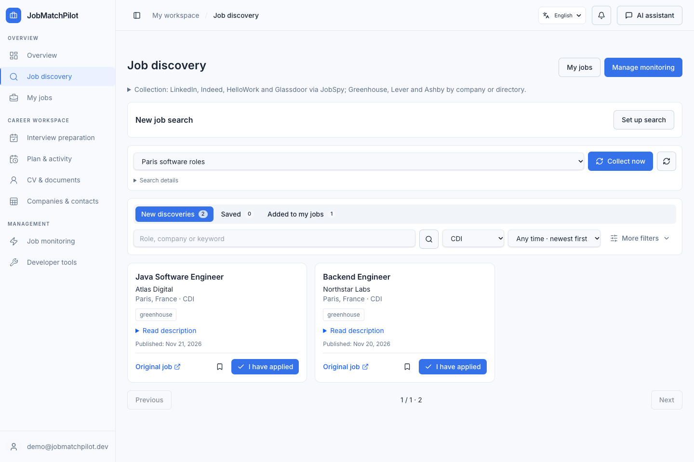
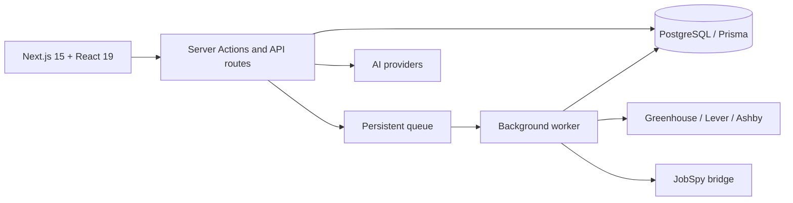

# JobMatchPilot

A workspace for finding jobs from a CV and managing the application process from first search to interview.

[](https://github.com/yangx219/jobmatchpilot/actions/workflows/ci.yml)


I built JobMatchPilot to replace the spreadsheets and disconnected tools I was using during my own job search. A CV becomes an editable search profile, job offers are collected and deduplicated, and the selected applications stay connected to tasks, activities and interview preparation.

The interface is available in English, French and Chinese. AI can be used for CV–job analysis, but it is not required for job collection and never sends an application on the user's behalf.


## Main workflow

1. Add a CV and define the target role, skills, location and contract type.
2. Create a monitoring rule for selected companies and job sources.
3. Review collected offers and open the original listing.
4. Save relevant jobs and track each application stage.
5. Plan follow-up tasks, record preparation time and prepare interview questions.

## Screenshots

### Job discovery

Monitoring rules and collected offers are managed on the same page. Results remain reviewable before they enter the application pipeline.



### Plan and activity

Tasks and time records share one workspace instead of being split across separate pages.


## Technical overview



| Area | Stack |
| --- | --- |
| Frontend | Next.js 15, React 19, TypeScript, Tailwind CSS, Radix UI |
| Backend | Server Actions, API routes, Zod, background worker |
| Data | PostgreSQL, Prisma, production migrations |
| Testing | Vitest, Testing Library, Playwright |
| Tooling | Docker Compose, ESLint, GitHub Actions |

The project runs on Node.js 22. Greenhouse, Lever and Ashby are integrated directly. JobSpy is used only for the additional LinkedIn, Indeed, HelloWork and Glassdoor collectors.

## Implementation notes

### Job deduplication

Offers are first matched by normalized URL. Tracking parameters and trailing slashes are removed before comparison. When a source does not provide a stable URL, the fallback key combines the normalized title, company and location.

Duplicates inside one collection are removed in memory. A PostgreSQL uniqueness constraint protects later runs from inserting the same source URL again.

### Background jobs

Collection requests are stored before they are executed. Workers claim available records with PostgreSQL locking, record each attempt and release failed work for retry. An expired lock makes work recoverable after a worker stops unexpectedly.

Writes are designed to be idempotent, so retrying a collection does not create another copy of the same offer.

### User data

Jobs, CVs, monitoring rules and workflow records are queried through their user ownership. Local environment files, imported documents and database volumes are excluded from Git.

## Run locally

Requirements: Node.js 22 and Docker.

```bash
git clone git@github.com:yangx219/jobmatchpilot.git
cd jobmatchpilot

node scripts/setup-local.mjs
npm ci
docker compose up -d db
npx prisma generate
npx prisma migrate deploy
npm run dev
```

Open [http://localhost:3737](http://localhost:3737).

The setup script creates a private `.env` with local secrets. A new installation starts with an empty PostgreSQL database.

To run the web app, worker and database with Docker:

```bash
node scripts/setup-local.mjs
docker compose up --build -d
```

## Verification

```bash
npx tsc --noEmit
npm run lint
npm test
npm run build
npm run test:e2e
```

Current baseline: 3,799 tests passing, 12 skipped, plus desktop and mobile Playwright scenarios. CI also applies the PostgreSQL migrations to a clean database before verifying the production schema.

## Project structure

```text
src/app/          Routes, server pages and API endpoints
src/actions/      Authenticated application actions
src/components/   Interface and workflow components
src/lib/          Queue, collectors and shared services
prisma/           Schema and PostgreSQL migrations
scripts/          Setup, workers and verification tools
e2e/              Playwright scenarios
docs/             Architecture and product documentation
```

## Project origin

JobMatchPilot started from [JobSync v1.2.0](https://github.com/gsync/jobsync). I kept the original MIT license and documented the inherited features and my changes in [docs/project/upstream.md](docs/project/upstream.md).

The optional JobSpy code under `vendor/jobspy/` also keeps its original license. My work around it covers the execution bridge, validation, queue integration and shared normalization pipeline.

## License

MIT — see [LICENSE](LICENSE).
