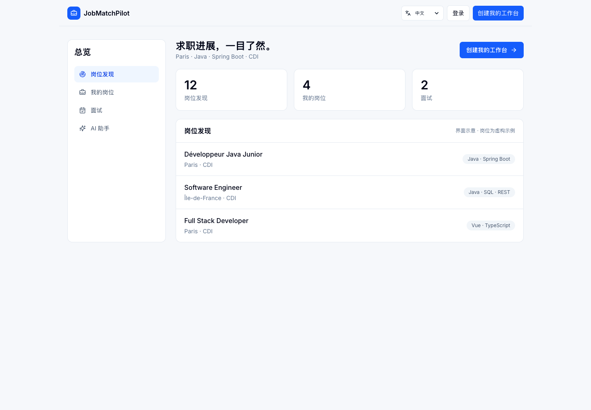
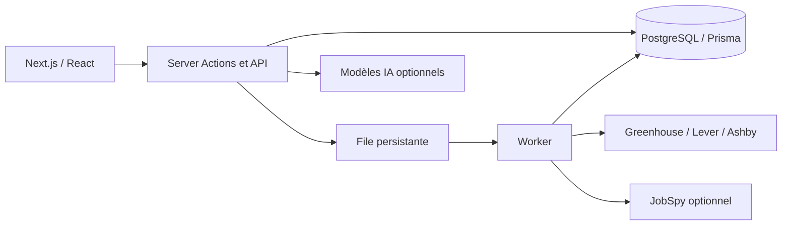

# JobMatchPilot

Plateforme Full Stack de recherche d’offres, d’analyse CV–poste et de suivi de candidatures.

`Next.js 15 · React 19 · TypeScript · PostgreSQL · Prisma · Docker · Playwright`

JobMatchPilot transforme un CV et des préférences en critères de recherche, collecte des offres depuis plusieurs sources, les normalise et les déduplique, puis centralise la préparation et le suivi des candidatures. L’analyse par IA reste facultative : aucune candidature n’est envoyée automatiquement.

> Projet personnel construit à partir du projet open source [JobSync](https://github.com/gsync/jobsync), distribué sous licence MIT. La séparation entre fonctionnalités héritées et contributions personnelles est documentée dans [l’origine du projet](docs/project/upstream.md).



## Fonctionnalités principales

- recherche multi-source : Greenhouse, Lever, Ashby et intégration optionnelle de JobSpy ;
- transformation d’un CV en critères de recherche modifiables ;
- normalisation des offres et déduplication entre sources et exécutions ;
- file PostgreSQL persistante avec verrouillage, tentatives et reprise après erreur ;
- isolation des données par utilisateur ;
- analyse CV–offre facultative avec validation humaine ;
- suivi des candidatures, tâches, activités et préparation aux entretiens ;
- interface français, anglais et chinois, adaptée au mobile ;
- tests unitaires, d’intégration et end-to-end.

## Parcours utilisateur

1. Ajouter ou créer un CV.
2. Définir le poste cible, les compétences et la localisation.
3. Sélectionner les sources et les entreprises.
4. Lancer une collecte immédiate ou planifiée.
5. Examiner les offres dédupliquées et ouvrir l’annonce d’origine.
6. Enregistrer une candidature et suivre ses étapes.
7. Préparer les tâches et entretiens dans un espace commun.

## Architecture



La collecte manuelle est enregistrée en base. Un worker la réclame de manière atomique, conserve son état et applique une stratégie de nouvelle tentative. Un verrou expiré permet de reprendre une tâche abandonnée après l’arrêt d’un worker. Les écritures sensibles doivent rester idempotentes afin qu’une reprise ne crée pas de doublon.

## Déduplication

La clé principale repose sur une URL normalisée : domaine, chemin, paramètres de suivi et slash final. Si l’URL n’est pas exploitable, une clé secondaire combine le titre normalisé, l’entreprise et la localisation. La base évite les doublons entre plusieurs exécutions ; un `Set` évite les doublons au sein d’un même lot.

Cette stratégie est volontairement explicable. Deux offres proches peuvent encore nécessiter une vérification humaine.

## Démarrage local

Prérequis : Node.js 22 et Docker.

```bash
node scripts/setup-local.mjs
npm ci
docker compose up -d db
npx prisma generate
npx prisma migrate deploy
npm run dev
```

Ouvrir <http://localhost:3737>.

Le script de configuration crée un fichier `.env` local avec un secret aléatoire. Les fichiers `.env`, CV importés, bases locales et données utilisateur ne sont jamais suivis par Git.

## Exécution complète avec Docker

```bash
node scripts/setup-local.mjs
docker compose up --build -d
docker compose logs -f app worker
```

- `/api/health` : test de vie sans dépendance externe ;
- `/api/health?ready=1` : vérifie PostgreSQL et l’environnement du collecteur ;
- le rôle `web` sert l’application ;
- le rôle `worker` consomme la file persistante et les tâches planifiées.

Les identifiants internes `offerflow` encore présents dans Docker et la base sont conservés uniquement pour la compatibilité avec les volumes locaux existants. Le produit public et les nouvelles interfaces utilisent le nom JobMatchPilot.

## Qualité

```bash
npx tsc --noEmit
npm run lint
npm test -- --run
npm run build
npm run test:e2e
```

État vérifié avant publication :

- contrôle TypeScript réussi ;
- ESLint réussi ;
- build de production réussi ;
- 3 799 tests réussis et 12 tests ignorés par conception ;
- scénarios Playwright desktop et mobile disponibles dans `e2e/`.

## Limites connues

- les plateformes publiques peuvent limiter ou refuser les requêtes ;
- la collecte ne garantit ni une couverture exhaustive ni un résultat en temps réel ;
- les descriptions et dates dépendent des données fournies par chaque source ;
- l’analyse IA est une aide explicable, pas une probabilité d’embauche ;
- aucune candidature n’est envoyée automatiquement ;
- un déploiement public nécessite HTTPS, sauvegardes, supervision et contrôle des inscriptions.

## Documentation

- [Index de la documentation](docs/README.md)
- [Origine open source et contributions](docs/project/upstream.md)
- [Workflow persistant](docs/architecture/workflows.md)
- [Modèle de données](docs/database/erd.md)
- [Internationalisation](docs/product/localization.md)
- [Guide de démarrage](docs/wiki/getting-started.md)

## Licence et attribution

MIT. Le copyright et la licence du projet JobSync d’origine sont conservés dans [LICENSE](LICENSE). Le code JobSpy inclus dans `vendor/jobspy/` conserve également sa licence et son attribution d’origine.
