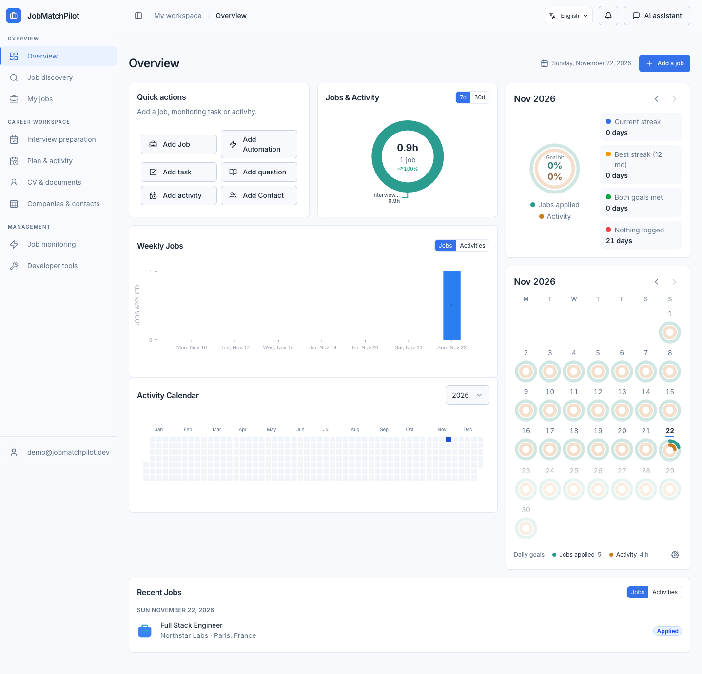
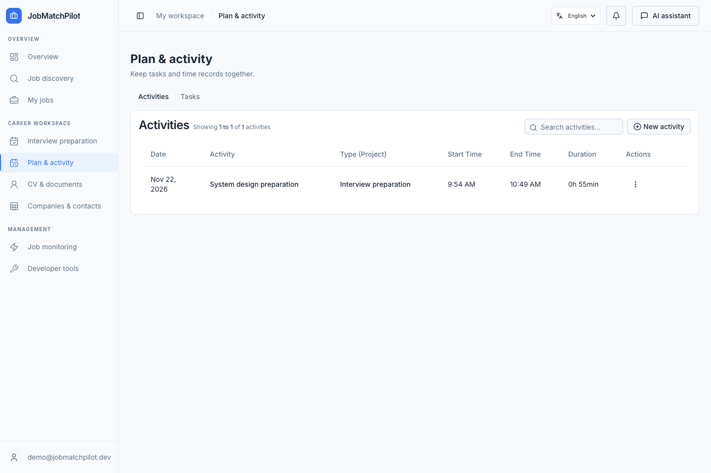
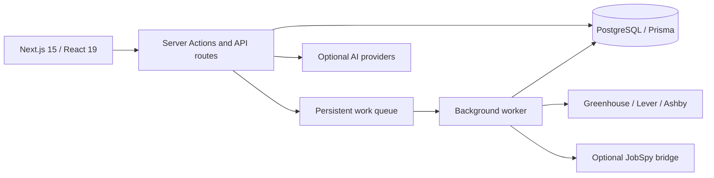

# JobMatchPilot

CV-driven job discovery, application tracking and interview preparation in one workspace.

[](https://github.com/yangx219/jobmatchpilot/actions/workflows/ci.yml)


JobMatchPilot turns a CV and job preferences into editable search criteria, collects vacancies from several sources, normalizes and deduplicates them, and keeps the complete application workflow in one place. AI analysis is optional and the application never submits a job application automatically.

> **Résumé en français —** JobMatchPilot est une plateforme Full Stack qui transforme un CV en critères de recherche, collecte et déduplique des offres multi-sources, puis centralise les candidatures, les tâches et la préparation aux entretiens. L'IA reste facultative et aucune candidature n'est envoyée automatiquement.



## Why this project?

Searching across several job boards creates fragmented data: duplicated vacancies, inconsistent titles, lost application history and disconnected interview notes. JobMatchPilot provides one explainable workflow:

1. Add or create a CV.
2. Define target roles, skills, locations and contract preferences.
3. Configure one or more public job sources.
4. Run a search immediately or on a schedule.
5. Review normalized, deduplicated vacancies and open the original listing.
6. Move selected jobs into the application tracker.
7. Manage tasks, activities, interview rounds and preparation questions.

## Product tour

### CV-driven job discovery

Create reusable monitoring rules, collect vacancies and review each result before adding it to the application pipeline. Standard collection works without an AI provider.


### Application overview

Track recent applications and time spent, inspect weekly activity and use the yearly calendar to identify gaps in the search routine.


### Planning and activity

Tasks and time records share one workspace, so preparation work remains connected to the overall job-search process.



## Engineering highlights

### Multi-source collection

- Native adapters for Greenhouse, Lever and Ashby.
- Optional JobSpy bridge for LinkedIn, Indeed, HelloWork and Glassdoor.
- Source-specific responses are converted into one internal job model.
- Provider failures are isolated so one unavailable source does not invalidate the whole run.

### Explainable deduplication

The primary key is built from a normalized listing URL: hostname and path are standardized, tracking parameters are removed and trailing slashes are ignored. When no reliable URL exists, a fallback key combines normalized job title, company and location.

A process-local `Set` removes duplicates inside one collection batch. PostgreSQL constraints prevent the same normalized vacancy from being stored again across later runs.

### Durable background processing

Manual and scheduled searches are stored in PostgreSQL before execution. A separate worker claims available jobs atomically, records attempts and keeps the final result.

- PostgreSQL locking prevents two workers from claiming the same item.
- Retryable failures return to the queue with a later availability time.
- Expired locks make interrupted work claimable again after a worker restart.
- Idempotent writes keep retries from creating duplicate business records.

### Data ownership and AI safety

- User-owned queries are scoped by `userId` or by an ownership relation.
- Imported CVs, application data and AI settings are not committed to Git.
- AI matching is optional and its output remains a recommendation for human review.
- API keys stay in the local environment or encrypted user settings.
- No automatic job application submission is implemented.

## Architecture



| Layer | Technologies |
| --- | --- |
| Frontend | Next.js 15, React 19, TypeScript, Tailwind CSS, Radix UI |
| Backend | Server Actions, API routes, worker process, Zod |
| Data | PostgreSQL, Prisma, production migrations |
| AI | OpenAI, Gemini, DeepSeek, OpenRouter or local Ollama — all optional |
| Quality | Vitest, Testing Library, Playwright, ESLint, TypeScript |
| Operations | Docker Compose, health checks, GitHub Actions |

## Run locally

### Requirements

- Node.js 22
- Docker with Docker Compose

### Development mode

```bash
git clone git@github.com:yangx219/jobmatchpilot.git
cd jobmatchpilot

node scripts/setup-local.mjs
npm ci
docker compose up -d db
npx prisma generate
npx prisma migrate deploy
npm run dev
```

Open [http://localhost:3737](http://localhost:3737).

`setup-local.mjs` creates a private `.env` with random local secrets. A fresh clone starts with an empty PostgreSQL database; reference data is created when an account is registered. Environment files, imported CVs and local user data are excluded from Git.

### Full Docker stack

```bash
node scripts/setup-local.mjs
docker compose up --build -d
docker compose logs -f app worker
```

Health endpoints:

- `/api/health` checks whether the web process is alive.
- `/api/health?ready=1` also checks PostgreSQL and collector configuration.

## Quality checks

```bash
npx tsc --noEmit
npm run lint
npm test
npm run build
npm run test:e2e
```

Current verified baseline:

- TypeScript check passed.
- ESLint passed.
- Production build passed.
- 3,799 tests passed; 12 intentionally skipped.
- Desktop and mobile Playwright scenarios cover the main workflows.
- PostgreSQL migrations are applied and verified in CI.

README screenshots can be regenerated against a local instance with isolated temporary data:

```bash
node --env-file=.env scripts/capture-readme.mjs
```

The temporary user and its demonstration records are deleted when the script finishes.

## Repository guide

```text
src/app/             Next.js routes, server pages and API endpoints
src/actions/         Authenticated application and domain actions
src/components/      Product UI and workflow components
src/lib/             Queue, collectors, normalization and shared services
prisma/              Schema and PostgreSQL migrations
scripts/             Local setup, workers, collectors and verification tools
e2e/                 Playwright end-to-end scenarios
docs/                Architecture, database and product documentation
vendor/jobspy/       Optional JobSpy integration with its original license
```

Further documentation:

- [Open-source origin and contribution boundaries](docs/project/upstream.md)
- [Persistent workflow design](docs/architecture/workflows.md)
- [Data model](docs/database/erd.md)
- [Internationalization](docs/product/localization.md)
- [Getting started guide](docs/wiki/getting-started.md)

## Known limitations

- Public job platforms may rate-limit, change or reject automated requests.
- Collection coverage and publication dates depend on each source.
- Similar vacancies without a stable URL may still require manual review.
- AI matching is an explainable assistant, not a hiring probability.
- A public deployment still requires HTTPS, backups, monitoring and registration controls.

## Open-source origin

JobMatchPilot is built on [JobSync v1.2.0](https://github.com/gsync/jobsync), released under the MIT License. Existing JobSync features and the work added for JobMatchPilot are listed separately in [the contribution document](docs/project/upstream.md).

The optional collector under `vendor/jobspy/` retains the original [JobSpy](https://github.com/speedyapply/JobSpy) license and attribution. JobMatchPilot's contribution is the isolated execution bridge, result validation, persistent task integration, source health reporting and shared deduplication pipeline.

## License

MIT. See [LICENSE](LICENSE) for the retained copyright and license notices.
