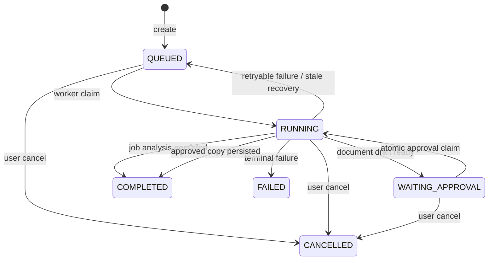

# Durable AI Workflows

本文只描述当前源码已实现的状态机，不把 V4 目标误写成现状。

## Workflow 类型

- `JOB_MATCH`：准备上下文 → 生成匹配 → 验证输出 → 原子保存分析。
- `COVER_LETTER`：准备上下文 → 生成草稿 → 验证 → 等待用户批准；批准后创建求职信。
- `RESUME_TAILOR`：准备上下文 → 生成逐项建议 → Schema 验证 → 等待用户选择；批准后克隆简历并应用建议。

## 状态机

## 已实现的一致性边界

- Claim 使用 PostgreSQL `FOR UPDATE SKIP LOCKED`，避免多个 Worker 领取同一条队列记录。
- `lockedAt`/`lockedBy` 和 stale recovery 使中断任务可重新排队。
- 创建支持用户级 `idempotencyKey`，并用输入指纹复用已完成结果。
- 所有 Subject 查询都带 `userId` 或用户关系约束。
- 审批先以条件更新抢占 `WAITING_APPROVAL`，再在事务内创建文档和完成 Workflow。
- 简历定制创建副本，不覆盖原始 Resume。
- 取消将 Workflow 和未完成 Step 一起标记为 `CANCELLED`。

## 尚待 V4 验证

- 在真实 PostgreSQL 上同时启动多个 claimant，证明只领取一次。
- 对同一审批并发请求，证明只创建一个文档副本。
- Provider 调用已开始后的取消不能保证外部计费停止；需记录并测试该边界。
- `AgentAuditEvent` 是应用级 append pattern，并非对 DBA 不可篡改。
- Match 的 evidence/gaps/uncertainty 字段需要端到端持久化与 UI 验证。
