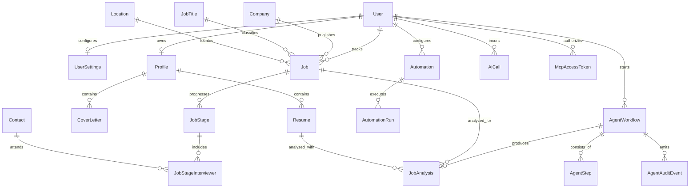

# JobMatchPilot 数据模型基线

本文件以 `prisma/schema.prisma` 为准。它是 V4 重构前的高层关系图，不替代 Prisma migrations。

## 关键约束

- `User.email` 唯一。
- `AgentWorkflow(userId, idempotencyKey)` 唯一。
- `AgentStep(workflowId, position)` 唯一。
- `JobAnalysis.workflowId` 唯一。
- Workflow、Job、Resume、Analysis 均保留用户归属链路。
- migrations 是生产结构变更的唯一交付方式；禁止用开发 reset 替代迁移。

## V4 演进原则

- 优先 Expand → Migrate → Contract，避免一次性破坏字段或关系。
- Demo 数据使用隔离环境和显式保护，不复用生产 reset。
- 若新增 ResumeVersion，应先定义与现有 Resume clone 语义的兼容迁移。
- Audit/Trace 不保存 API key、完整简历正文或未脱敏 Prompt。
